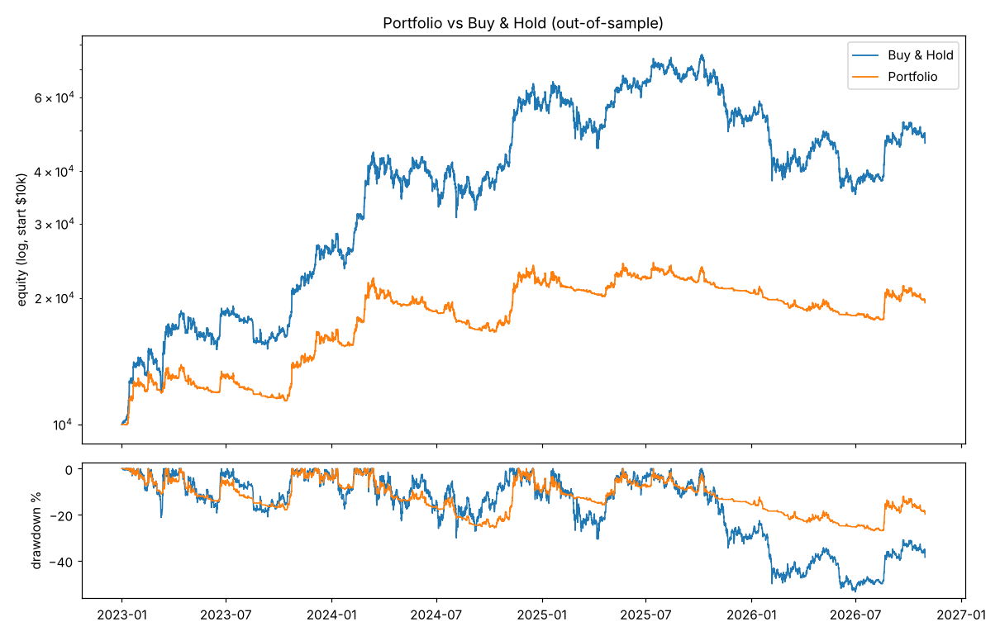
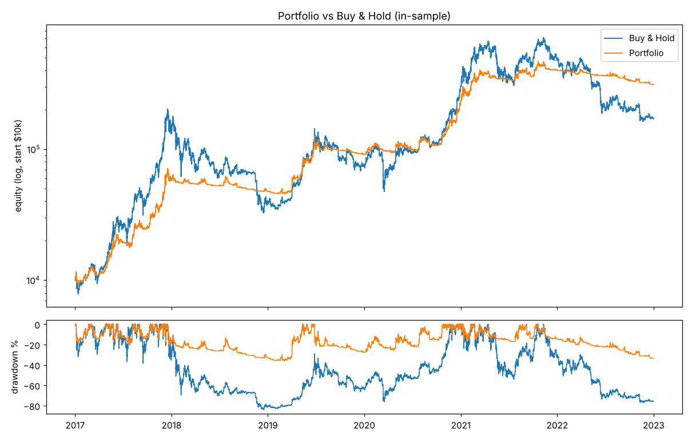
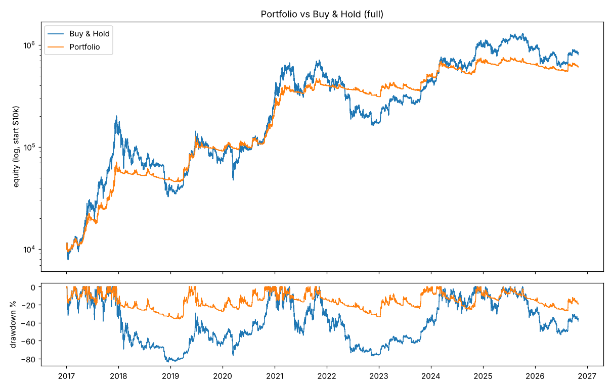
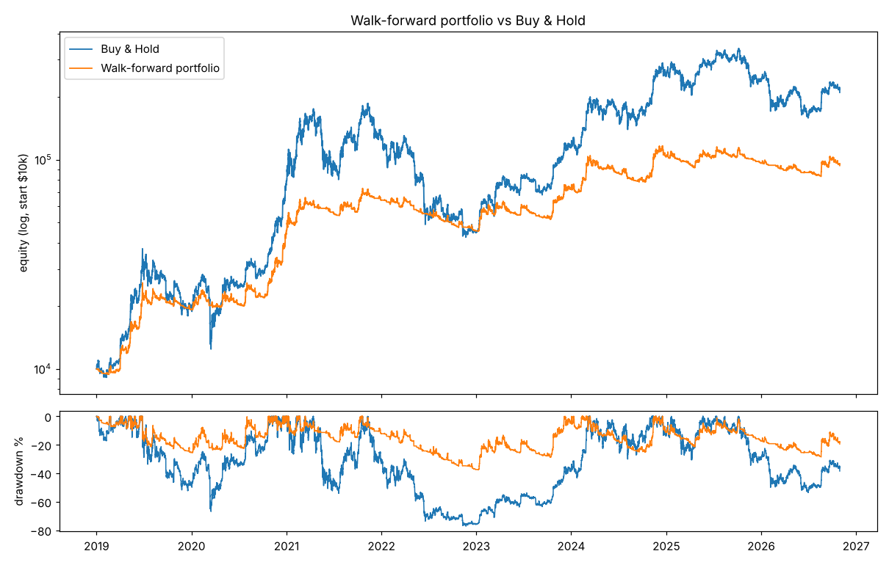

# Backtest results

Data: Bitstamp BTC/USD, 1-minute candles resampled to 4h / 1d. Costs: 0.10% fee + 0.05% slippage per side. Long-only, no leverage. Signals are computed on closed candles and applied from the next bar.

Strategies and parameters were chosen **only** on 2017-01-01 .. 2023-01-01. Everything from 2023-01-01 on is out-of-sample (never seen during selection).

## out-of-sample

| index | cagr | sharpe | max_drawdown | calmar | exposure | trades | win_rate | profit_factor |
|---|---|---|---|---|---|---|---|---|
| Buy & Hold | 49.6% | 1.11 | -53.6% | 0.93 | 100.0% | 1 | 100.0% | inf |
| PORTFOLIO | 19.0% | 0.87 | -26.9% | 0.71 | 93.4% | 38 | 18.4% | 6.69 |
| ema_trend@4h | 20.6% | 0.79 | -34.5% | 0.60 | 40.9% | 114 | 35.1% | 1.67 |
| donchian_breakout@4h | 22.7% | 0.95 | -27.8% | 0.82 | 30.2% | 82 | 41.5% | 1.92 |
| bb_squeeze@4h | -5.2% | -0.15 | -39.3% | -0.13 | 22.4% | 142 | 26.8% | 1.08 |
| vol_momentum@4h | 25.0% | 0.95 | -37.3% | 0.67 | 81.0% | 135 | 23.7% | 2.81 |
| ema_trend@1d | 11.0% | 0.50 | -40.4% | 0.27 | 44.3% | 19 | 42.1% | 1.97 |
| donchian_breakout@1d | 25.4% | 0.90 | -35.9% | 0.71 | 48.1% | 22 | 45.5% | 2.69 |
| vol_momentum@1d | 26.6% | 0.97 | -30.8% | 0.86 | 87.1% | 27 | 29.6% | 6.19 |

## in-sample

| index | cagr | sharpe | max_drawdown | calmar | exposure | trades | win_rate | profit_factor |
|---|---|---|---|---|---|---|---|---|
| Buy & Hold | 60.6% | 0.99 | -83.9% | 0.72 | 100.0% | 1 | 100.0% | inf |
| PORTFOLIO | 77.4% | 1.76 | -36.1% | 2.14 | 88.9% | 108 | 25.9% | 17.28 |
| ema_trend@4h | 98.4% | 1.57 | -61.1% | 1.61 | 44.7% | 157 | 39.5% | 2.46 |
| donchian_breakout@4h | 87.5% | 1.70 | -35.7% | 2.45 | 32.4% | 111 | 49.5% | 3.18 |
| bb_squeeze@4h | 55.3% | 1.48 | -25.8% | 2.14 | 24.6% | 189 | 46.0% | 2.27 |
| vol_momentum@4h | 46.8% | 1.46 | -37.0% | 1.27 | 78.1% | 227 | 28.2% | 5.68 |
| ema_trend@1d | 92.3% | 1.49 | -62.6% | 1.47 | 43.4% | 29 | 55.2% | 5.98 |
| donchian_breakout@1d | 86.3% | 1.45 | -52.8% | 1.63 | 47.0% | 27 | 51.9% | 6.58 |
| vol_momentum@1d | 48.3% | 1.39 | -42.5% | 1.13 | 78.1% | 52 | 25.0% | 8.34 |

## full

| index | cagr | sharpe | max_drawdown | calmar | exposure | trades | win_rate | profit_factor |
|---|---|---|---|---|---|---|---|---|
| Buy & Hold | 56.2% | 1.00 | -83.9% | 0.67 | 100.0% | 1 | 100.0% | inf |
| PORTFOLIO | 51.8% | 1.47 | -36.1% | 1.44 | 90.6% | 146 | 24.0% | 14.70 |
| ema_trend@4h | 63.5% | 1.32 | -61.1% | 1.04 | 43.2% | 271 | 37.6% | 2.22 |
| donchian_breakout@4h | 59.0% | 1.45 | -35.7% | 1.65 | 31.5% | 193 | 46.1% | 2.74 |
| bb_squeeze@4h | 28.1% | 0.99 | -42.5% | 0.66 | 23.8% | 331 | 37.8% | 1.78 |
| vol_momentum@4h | 37.9% | 1.27 | -37.3% | 1.01 | 79.3% | 362 | 26.5% | 4.44 |
| ema_trend@1d | 55.2% | 1.19 | -62.6% | 0.88 | 43.7% | 48 | 50.0% | 4.70 |
| donchian_breakout@1d | 59.7% | 1.27 | -52.9% | 1.13 | 47.4% | 49 | 49.0% | 5.21 |
| vol_momentum@1d | 39.4% | 1.23 | -42.5% | 0.93 | 81.6% | 79 | 26.6% | 7.81 |

## Calendar-year returns

| time | Portfolio | Buy & Hold |
|---|---|---|
| 2017 | 488.1% | 1,341.6% |
| 2018 | -18.7% | -73.4% |
| 2019 | 91.5% | 94.1% |
| 2020 | 152.9% | 304.5% |
| 2021 | 73.0% | 59.4% |
| 2022 | -22.1% | -64.2% |
| 2023 | 58.5% | 155.7% |
| 2024 | 35.9% | 121.0% |
| 2025 | -4.9% | -6.3% |
| 2026 | -5.0% | -11.7% |

## Fee sensitivity (out-of-sample)

| index | cagr | sharpe | max_drawdown |
|---|---|---|---|
| fee 0.05% + 0.05% slip | 21.4% | 0.96 | -25.4% |
| fee 0.10% + 0.05% slip | 19.0% | 0.87 | -26.9% |
| fee 0.20% + 0.05% slip | 14.3% | 0.70 | -30.4% |

## Walk-forward (most realistic estimate)

Every January the whole selection + optimisation is re-run on all prior data (from 2017) and the resulting portfolio is traded, unseen, for that year.

| index | cagr | sharpe | max_drawdown | calmar | exposure | trades | win_rate | profit_factor |
|---|---|---|---|---|---|---|---|---|
| walk-forward | 33.1% | 1.16 | -37.5% | 0.88 | 87.2% | 136 | 16.9% | 5.46 |
| Buy & Hold | 47.5% | 0.95 | -77.1% | 0.62 | 100.0% | 1 | 100.0% | inf |

## Portfolio members

| member | params |
|---|---|
| ema_trend@4h | `{'fast': 10, 'slow': 200, 'adx_min': 25, 'atr_mult': 3.0}` |
| donchian_breakout@4h | `{'entry': 40, 'exit': 10, 'atr_mult': 6.0}` |
| bb_squeeze@4h | `{'length': 20, 'k': 1.5, 'lookback': 60, 'pct': 0.1, 'atr_mult': 3.0}` |
| vol_momentum@4h | `{'lookbacks': (10, 30, 60), 'target_vol': 0.4, 'vol_days': 60, 'band': 0.1, 'bars_per_day': 6}` |
| ema_trend@1d | `{'fast': 10, 'slow': 50, 'adx_min': 25, 'atr_mult': 3.0}` |
| donchian_breakout@1d | `{'entry': 20, 'exit': 10, 'atr_mult': 6.0}` |
| vol_momentum@1d | `{'lookbacks': (30, 90, 180), 'target_vol': 0.4, 'vol_days': 15, 'band': 0.1, 'bars_per_day': 1}` |
